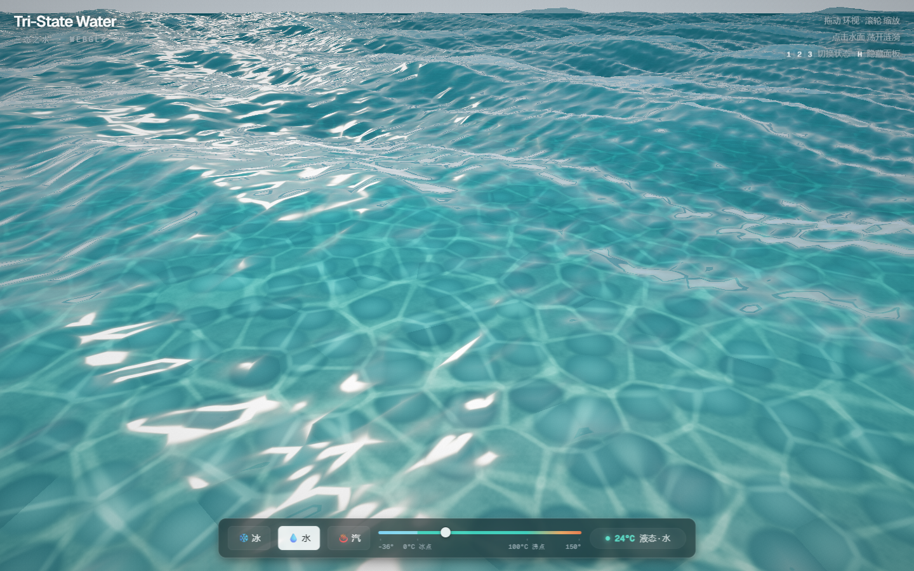
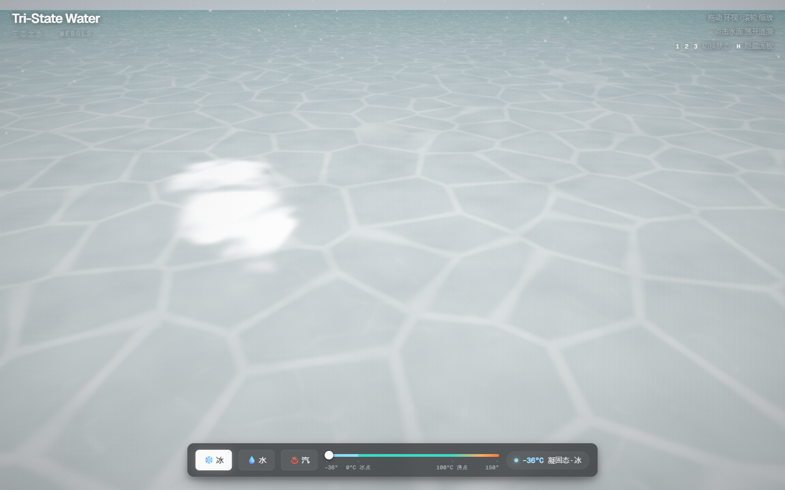
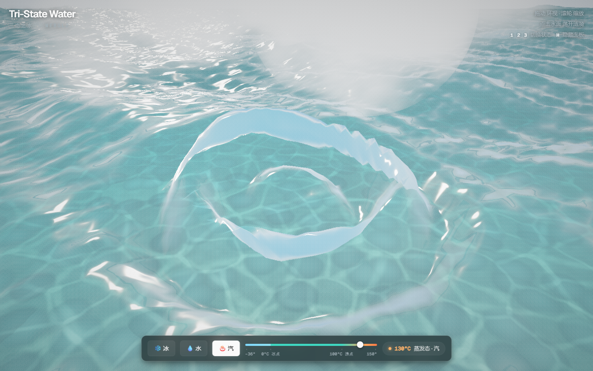

# 三态之水 · Tri-State Water

一个**单文件、零依赖、纯 WebGL2** 的实时交互水场景 —— 复刻开源项目
[clearwater](https://github.com/Aureliengmz/clearwater)（MIT）的视觉与技术路线，并新增
**温度三态系统**：让水随温度在 凝固态（冰）⇄ 液态（水）⇄ 蒸发态（汽）之间连续变化。





## 运行

无需安装、无需构建 —— 直接双击打开 `index.html` 即可。渲染代码零依赖；在线 Geist 字体加载失败时会自动回退到系统字体。

也可以起个本地服务器：

```bash
python -m http.server 8000
# 打开 http://localhost:8000
```

要求浏览器支持 **WebGL2**（Chrome / Edge / Firefox / Safari 较新版本均可）。

## 操作

| 操作 | 效果 |
| --- | --- |
| 拖动 | 环视场景 |
| 点击水面 | 荡开涟漪 |
| `1` / `2` / `3` | 一键切换 冰 / 水 / 汽 |
| `H` | 隐藏 / 显示面板 |

## 温度三态

底部滑杆可在 **-36°C ~ 150°C** 间连续调节，温度值本身做了缓动，
因此可以**看见水逐渐结冰、或逐渐沸腾汽化**的过程：

- **凝固态（< 0°C）**：波幅衰减至冻结，表面生成霜纹与冰裂纹、
  晶体闪光，焦散变得锐利，降雪开始飘落；低于约 -12°C 后完全冰封，点击不再起涟漪；
  逼近 **-36°C** 时冰层愈发厚实——更乳白、更不透明、裂纹更深，冰下几乎不再透光。
- **液态（0 ~ 100°C）**：默认的清澈浅水 —— 碧波、水底卵石与游动焦散、
  太阳眩光；水温升高时水体逐渐变暖变浊。
- **蒸发态（> 100°C）**：水面开始沸腾扰动，白色蒸汽羽流升腾、
  热浪扭曲画面、蒸汽薄雾弥漫，远景逐渐朦胧。

## URL 参数

- `?state=ice|water|steam` — 载入即置为某一状态；切换预设或拖动滑杆时，当前状态会自动同步回地址栏（可分享）
- `?temp=68` — 以指定温度启动（-36°C ~ 150°C），拖动滑杆后自动写入 URL，支持分享精确温度
- `?quality=low` — 低负载档位：缩减水面网格/波列并降低分辨率，便于低功耗设备与软件渲染验证
- `?ui=0` — 隐藏界面（适合截图）
- `?debug` — 右下角显示帧率与渲染分辨率

## 技术要点

全部代码在 [index.html](index.html) 一个文件内，无任何库：

- **海面**：最多 22 个按深水色散关系取速的波列，以主风向和少量交叉涌浪组织；按网格间距剔除过短波，顶点级解析法线，
  片元级双层平流微法线及毛细纹理。
- **交互涟漪**：24 个涟漪槽（环形缓冲），扩散波包 + 阻尼，解析梯度参与法线。
- **焦散**：海床上双层动态 Worley 网纹，随冰冻变为锐利晶状。
- **海床**：程序化卵石（Worley 元胞着色 + 假 AO）与沙地噪声。
- **水体**：IOR≈1.333 的 Schlick Fresnel 掠射角反射 + 日照高光 + 预乘 Alpha 的体散射近似；
  海床采用 per-channel Beer 吸收，离屏帧缓冲配备真实深度附件。
- **三态驱动**：`uIce / uSteam / uWarm / uSnow` 等参数由温度平滑推导，
  在着色器中混合冰纹、沸腾扰动、蒸汽公告板羽流与热浪后处理。
- **后处理**：HDR 半浮点场景缓冲（浮点线性采样能力检测）→ 精简采样的太阳眩光 + 光条 →
  热浪扭曲 → ACES 色调映射 → 暗角与胶片颗粒。
- **自适应画质**：按帧时间自动升降渲染分辨率，保证流畅。
- **界面**：围绕真实场景的轻量材质实验室控制台（见 [DESIGN.md](DESIGN.md) 原始规范），
  保留 Geist 排版、弱分隔和深色磨砂玻璃；
  滑杆刻度与渐变均按真实温度位置（0°C = 19.35%，100°C = 73.1%）对齐；
  全键盘可操作（焦点环、`aria-pressed`、`aria-live`），
  支持 `prefers-reduced-motion`（包括冻结水面模拟时钟）、精确温度 URL、隐藏控件时退出 Tab 顺序，
  并处理 WebGL 上下文丢失恢复。

## 浏览器验收

仓库自带 [Playwright 可视化冒烟测试](tests/visual-smoke.mjs)，在 GitHub Actions 中验证
冰 / 水 / 汽三个状态的 WebGL2 初始化与持续渲染、移动端面板边界、预设及精确温度 URL，
并上传五张桌面和移动端截图供人工视觉评审。

本地运行：先使用 `python3 -m http.server 4173` 启动静态服务，
另开终端执行 `npm install --no-save playwright && npx playwright install chromium && node tests/visual-smoke.mjs`。
如果测试设备没有浏览器/显卡驱动，请使用 GitHub Actions 中的 SwiftShader 软件渲染测试。

## 致谢

视觉概念与技术路线复刻自 [Aureliengmz/clearwater](https://github.com/Aureliengmz/clearwater)
（Claude Opus 一次性生成的 3D 水，作者已 MIT 开源）—— *"show me what you make with it"*。
本仓库代码为独立手写实现，未复制其源码。

## License

MIT
